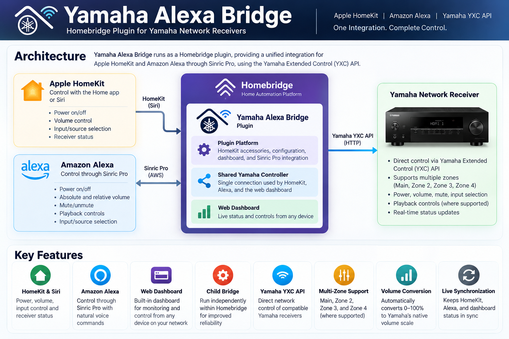
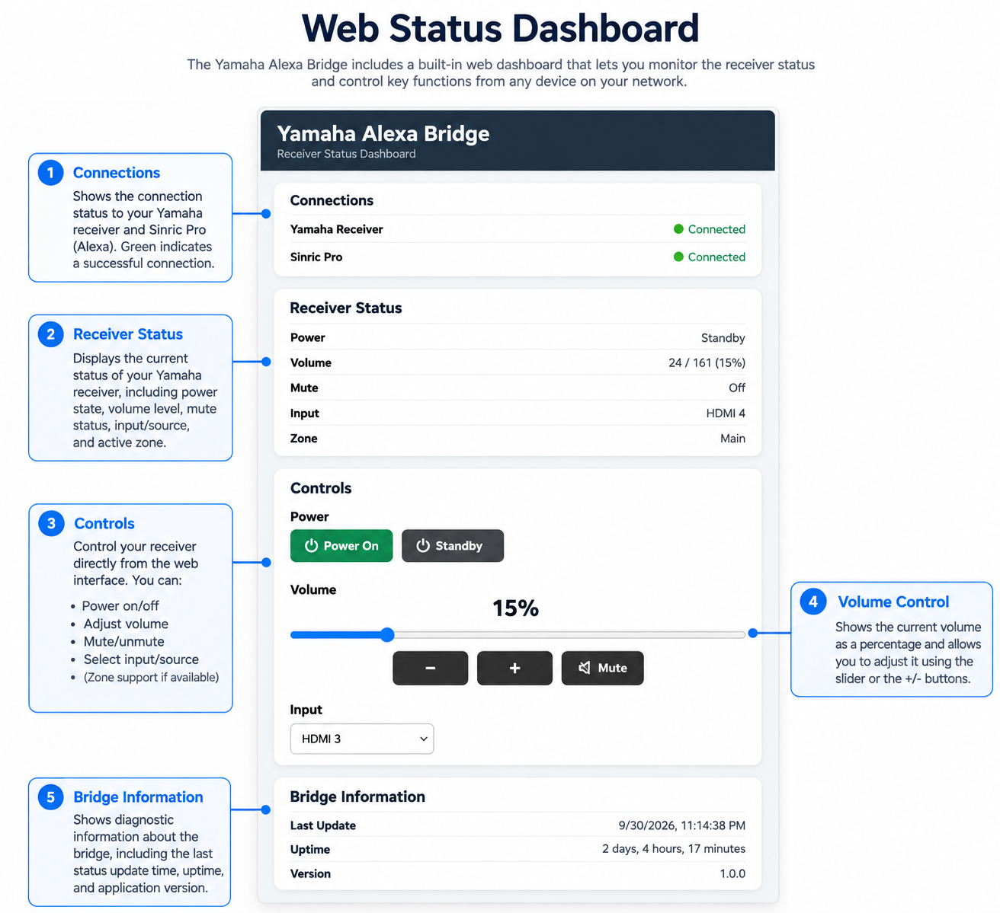

# Yamaha Alexa Bridge

[](https://www.npmjs.com/package/homebridge-yamaha-alexa-bridge)
[](https://homebridge.io/)
[](LICENSE)

Yamaha Alexa Bridge is a Homebridge platform plugin for controlling a compatible Yamaha network receiver from Apple Home and Siri, Amazon Alexa, or a web browser. It communicates with the receiver over Yamaha's local Yamaha Extended Control (YXC) API. Alexa integration uses Sinric Pro.

[](docs/architecture.png)

Homebridge hosts the plugin. HomeKit communicates with the Homebridge accessory, Alexa commands arrive through Sinric Pro, and the dashboard provides browser controls. Each path communicates with the configured receiver and zone over the local network.

## Features

- HomeKit and Siri power and speaker-volume control, with receiver power and volume status synchronization.
- Alexa power, absolute and relative volume, mute, media controls, and input selection through Sinric Pro.
- A built-in dashboard for Yamaha and Sinric Pro connection status, receiver status, and power, volume, mute, and input controls.
- One configured Yamaha zone shared by the HomeKit accessory, Alexa integration, and dashboard.
- Configurable input names mapped to Yamaha input identifiers.
- Volume conversion between a 0–100 percentage and the receiver's native volume scale.
- Homebridge UI configuration for the platform's standard fields.

## Requirements

- Homebridge 2.x.
- Node.js 22 or later.
- A Yamaha receiver with the Yamaha Extended Control API enabled and reachable over the local network.
- A Sinric Pro account, app credentials, and a Sinric Pro TV device for Alexa integration.

Supported zones, inputs, and playback functions vary by Yamaha model and source. Check the receiver documentation and the YXC status response for the selected zone.

## Install

In Homebridge UI, open **Plugins**, search for **Yamaha Alexa Bridge**, and install `homebridge-yamaha-alexa-bridge`. Add the platform configuration below, save, then restart Homebridge. Alternatively, install on the Homebridge host with:

```sh
npm install -g homebridge-yamaha-alexa-bridge
```

## Configure

Create a Sinric Pro TV device and copy its App Key, App Secret, and Device ID into the platform configuration. Replace the example receiver address with the Yamaha receiver's reserved local IP address.

```json
{
  "platform": "YamahaAlexaBridge",
  "name": "Yamaha Receiver",
  "ip": "192.168.1.100",
  "zone": "main",
  "inputMap": {
    "HDMI 1": "hdmi1",
    "HDMI 2": "hdmi2",
    "Bluetooth": "bluetooth",
    "Spotify": "spotify"
  },
  "sinricpro": {
    "appKey": "YOUR_APP_KEY",
    "appSecret": "YOUR_APP_SECRET",
    "deviceId": "YOUR_DEVICE_ID"
  },
  "dashboard": {
    "enabled": true,
    "port": 8080,
    "auth": {
      "username": "dashboard-user",
      "password": "REPLACE_WITH_A_PRIVATE_PASSWORD"
    }
  }
}
```

| Setting | Purpose |
| --- | --- |
| `name` | Name shown for the HomeKit accessory and used to identify the receiver. |
| `ip` | Yamaha receiver's local IPv4 address. |
| `zone` | YXC zone used for receiver commands, such as `main` or a zone supported by the receiver. Defaults to `main` in the plugin. |
| `inputMap` | Optional mapping from friendly input names to Yamaha input IDs. The names are used for Alexa input selection and dashboard choices. |
| `sinricpro.appKey` | Sinric Pro application key. |
| `sinricpro.appSecret` | Sinric Pro application secret. |
| `sinricpro.deviceId` | ID of the Sinric Pro TV device. |
| `dashboard.enabled` | Set to `false` to disable the dashboard; otherwise it starts by default. |
| `dashboard.port` | Dashboard TCP port; defaults to `8080`. |
| `dashboard.auth.username` | Optional username for dashboard HTTP Basic Auth. |
| `dashboard.auth.password` | Optional password for dashboard HTTP Basic Auth. Set it together with the username. |

The Homebridge configuration schema exposes the platform, receiver, input mapping, Sinric Pro, dashboard, and optional dashboard authentication fields. Set both authentication fields or leave both empty.

Keep Sinric Pro credentials private. Do not publish a live Homebridge configuration or commit credentials to source control.

### Reserve the receiver's IP address

Create a DHCP reservation for the Yamaha receiver in your router and use that address in `ip`. A reservation keeps the address stable when the receiver reconnects or restarts. If the address changes, the plugin cannot reach the receiver until the Homebridge configuration is updated.

## HomeKit and Siri

The plugin publishes a television accessory with a linked speaker service for the configured receiver and zone.

| HomeKit control | Behavior |
| --- | --- |
| Power | Reads Yamaha power status and sends power-on or standby commands. |
| Volume | Reads the receiver volume and sets an absolute volume percentage. |
| Volume adjustment | Uses HomeKit's volume selector to raise or lower Yamaha volume by five native-scale units. |
| Status synchronization | Polls power and volume every five seconds and updates HomeKit when values change. |

Pair the Homebridge bridge with Apple Home using your normal Homebridge setup. The accessory then appears in Home and is available to Siri. Mute, input selection, and playback are not exposed as HomeKit controls by this plugin.

## Alexa and Sinric Pro

The plugin registers the configured Sinric Pro TV device and connects using the App Key and App Secret. To finish setup:

1. Create a TV device in Sinric Pro and copy its App Key, App Secret, and Device ID into Homebridge.
2. Link the Sinric Pro Alexa skill to the Amazon account that will control the receiver.
3. Discover devices in Alexa and use the device name configured for the receiver.
4. Check Homebridge logs for Sinric Pro connection status if the device does not respond.

The integration handles these Sinric Pro TV callbacks:

| Alexa action | Sinric Pro callback | Yamaha operation |
| --- | --- | --- |
| Turn the receiver on or off | Power state | Sets the configured zone to power on or standby. |
| Set volume | Volume | Converts the requested 0–100 value to the Yamaha volume scale. |
| Raise or lower volume | Adjust volume | Applies the relative change to the current Yamaha volume, bounded by the receiver's reported maximum. |
| Mute or unmute | Mute | Sets mute on the configured zone. |
| Play, pause, stop, next, previous, fast forward, rewind | Media control | Sends the corresponding YXC NetUSB playback action. The receiver/source must support it. |
| Select an input | Input selection | Maps the friendly input name through `inputMap`, then sends the Yamaha input ID. |

Example requests include “Alexa, turn on Yamaha Receiver,” “Alexa, set Yamaha Receiver volume to 30 percent,” and “Alexa, mute Yamaha Receiver.” Exact phrases and availability depend on Alexa, the linked Sinric Pro skill, and the receiver's capabilities.

### Input mapping

`inputMap` keys are the friendly names used for input selection; values are Yamaha input IDs. Use IDs supported by your receiver. For example, `"HDMI 1": "hdmi1"` makes the friendly name `HDMI 1` map to the YXC input ID `hdmi1`. The dashboard uses the same mapping to populate its input selector. If you omit a custom mapping, the dashboard supplies a common built-in list; Alexa falls back to converting an unmapped input name to lowercase with spaces replaced by underscores. Verify the resulting ID against the receiver's YXC documentation.

## Web dashboard

The dashboard starts by default on port `8080`. From a device that can reach the Homebridge host, open `http://<homebridge-host>:8080`. Set `dashboard.port` to another port or set `dashboard.enabled` to `false` to disable it.

[](docs/dashboard.png)

The page shows Yamaha and Sinric Pro connection state, receiver status, input, and update information. It provides power, volume, mute, and mapped input controls. Dashboard status refreshes from the Yamaha receiver every two seconds, and browser clients receive live status updates. The HomeKit accessory reads power and volume from one shared status request per synchronization; simultaneous status requests are coalesced.

The dashboard listens on all network interfaces. Set both `dashboard.auth.username` and `dashboard.auth.password` to require HTTP Basic Auth for the page and its control/status endpoints. If only one is set, Homebridge logs a dashboard configuration error and does not start the dashboard.

**Security:** Basic Auth credentials travel over plain HTTP, so use it only on a trusted private network. Do not forward the dashboard port to the internet. For remote access, use a VPN or a trusted HTTPS reverse proxy.

## Yamaha YXC compatibility and volume

The plugin sends HTTP requests to the receiver's Yamaha Extended Control API. To check that the main zone is reachable, open this URL from a device on the same network, replacing the example address:

```text
http://<receiver-ip>/YamahaExtendedControl/v1/main/getStatus
```

A JSON response containing receiver status confirms that the endpoint can be reached. The configured `zone` is included in zone-specific status and control requests. Use a zone name and commands supported by your model. Playback commands use the YXC `netusb` endpoint and therefore depend on a compatible source.

HomeKit and Alexa use a 0–100 volume percentage for absolute volume. The plugin converts it to the receiver's native scale using the receiver's reported `max_volume` when available; the controller starts with a maximum of 161 before it learns a reported maximum. Relative HomeKit volume adjustment is five native-scale units per step. Alexa relative adjustment is applied to the current native volume and bounded between zero and the reported maximum.

Yamaha HTTP requests time out after five seconds of inactivity. Non-success HTTP responses are reported to Homebridge logs and returned to the controlling client as command failures.

## Troubleshooting

### The receiver is unreachable

- Confirm the receiver and Homebridge host are on the same reachable local network.
- Check the receiver IP and `zone` in the platform configuration.
- Open the YXC status URL above from the Homebridge host's network.
- Confirm the receiver's YXC network control is enabled and reserve its IP address in the router.

### HomeKit shows stale status or cannot control the receiver

- Confirm the receiver is reachable and supports the selected zone.
- Check the Homebridge log for Yamaha request errors.
- Verify that the Homebridge accessory is paired through the expected Homebridge bridge.

### Alexa cannot control the receiver

- Check the App Key, App Secret, and Device ID in the Homebridge platform configuration.
- Confirm the TV device is online in Sinric Pro and the Sinric Pro Alexa skill is linked to the correct account.
- Rediscover devices in Alexa and check Homebridge logs for Sinric Pro connection errors.
- For input selection, confirm the friendly name and Yamaha input ID in `inputMap`.

### A Yamaha input or playback command fails

- Confirm that the selected input ID is valid for your Yamaha model and zone.
- Playback commands apply to compatible NetUSB sources; they may not work for every input.
- Check the Homebridge log for the Yamaha API response.

### The dashboard does not open or a control fails

- Confirm the dashboard is enabled and browse to `http://<homebridge-host>:<configured-port>`.
- Check that the configured port is available and allowed through the host firewall.
- Make sure the viewing device can reach the Homebridge host on the local network.
- Check the page's Yamaha connection status and Homebridge log for receiver request errors.

## Development

```sh
git clone https://github.com/storkpkp/yamaha-alexa-bridge-2.git
cd yamaha-alexa-bridge-2
npm install
npm test
```

The Homebridge entry point is `homebridge/index.js`. The platform and accessory are in `homebridge/`; the Yamaha controller, Sinric Pro integration, and dashboard are in `lib/`. The built-in Node.js test runner checks controller requests and dashboard authentication. The package requires Node.js 22 or later and Homebridge 2.x.

## License

MIT
